# Calculadora de Válvulas de Alivio — API 520 Parte I

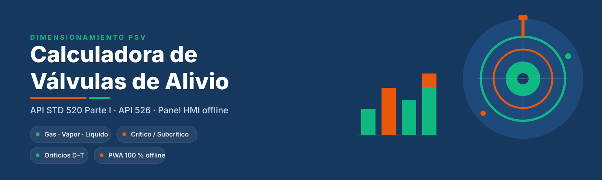

**Dimensionamiento de capacidad y área de orificio de válvulas de alivio a presión (PSV)** según **API STD 520 Parte I (10.ª edición)** con selección de orificio estándar **API STD 526**.

Aplicación web estática, sin backend y 100 % offline: panel HMI industrial en tema claro (por defecto) y tema oscuro Solarized, bilingüe ES/EN, instalable como PWA y con hoja de especificación exportable.

[](CHANGELOG.md)
[](tests/run.js)
[](LICENSE)
[](manifest.json)
[

---

## Contenido

- [Qué resuelve](#qué-resuelve)
- [Capturas](#capturas)
- [Diagrama de flujo](#diagrama-de-flujo)
- [Funcionalidad](#funcionalidad)
- [Motor de cálculo](#motor-de-cálculo)
- [Unidades y conversiones](#unidades-y-conversiones)
- [Selección de orificio API 526](#selección-de-orificio-api-526)
- [Supuestos, aproximaciones y límites](#supuestos-aproximaciones-y-límites)
- [Arquitectura](#arquitectura)
- [Estructura del proyecto](#estructura-del-proyecto)
- [Ejecución](#ejecución)
- [Pruebas](#pruebas)
- [Rendimiento, offline y privacidad](#rendimiento-offline-y-privacidad)
- [Accesibilidad y diseño](#accesibilidad-y-diseño)
- [Referencias](#referencias)
- [Aviso de ingeniería](#aviso-de-ingeniería)
- [Licencia](#licencia)

---

## Qué resuelve

Dado un servicio de alivio (fluido, presión de ajuste, sobrepresión, contrapresión, temperatura y caudal), la app calcula:

1. La **presión de alivio absoluta** `P1` y el **régimen de flujo** (crítico o subcrítico).
2. El **área efectiva requerida** de descarga en pulgadas cuadradas.
3. El **orificio API 526** inmediatamente superior (D–T) y su **capacidad real certificada**.
4. El **uso del orificio**, el **margen de capacidad** y los factores de corrección aplicados (`C`, `F2`, `Kb`, `Kw`, `Ksh`, `Kv`, `Kc`).
5. Una **hoja de especificación** con formato API 520 / ISA S20, copiable, exportable a PDF o imprimible.

Todo el cálculo corre en el navegador. No se envían datos a ningún servidor.

## Capturas

Vista completa del panel (clic para abrir la imagen a tamaño real):

[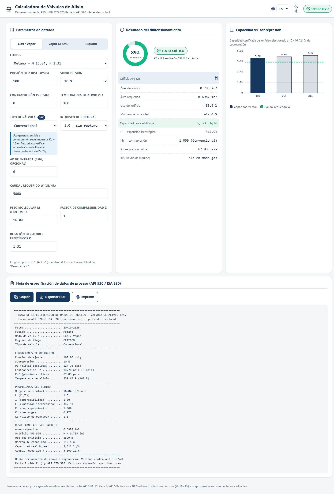](docs/screenshots/00-panel-completo.png)

| Gas / vapor — flujo crítico | Gas / vapor — flujo subcrítico exacto |
|---|---|
| 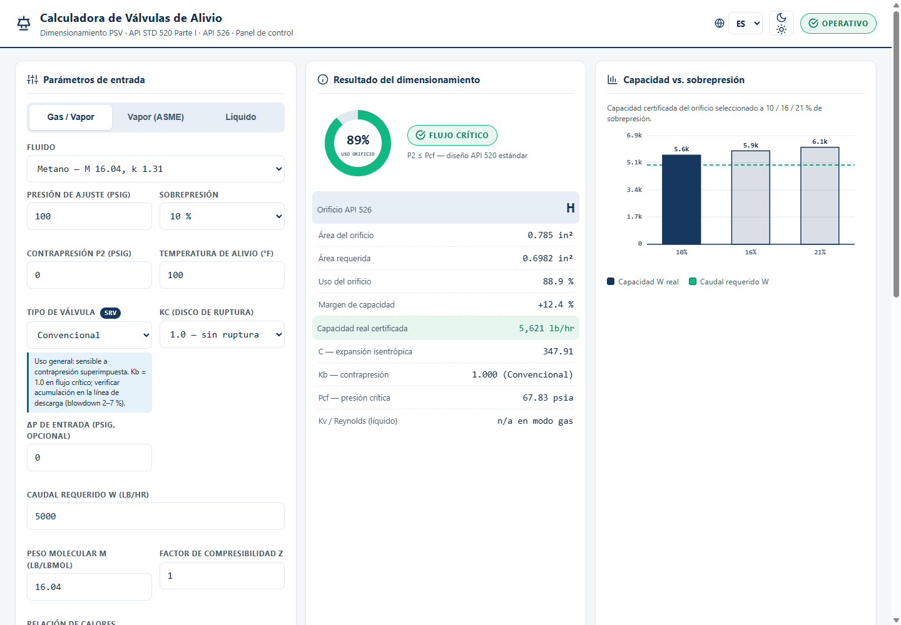 | 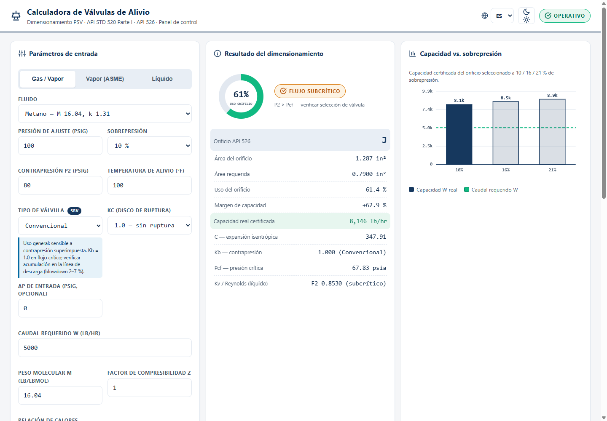 |
| **Vapor ASME — sobrecalentado (Ksh)** | **Líquido — diésel, Kv y Reynolds** |
| 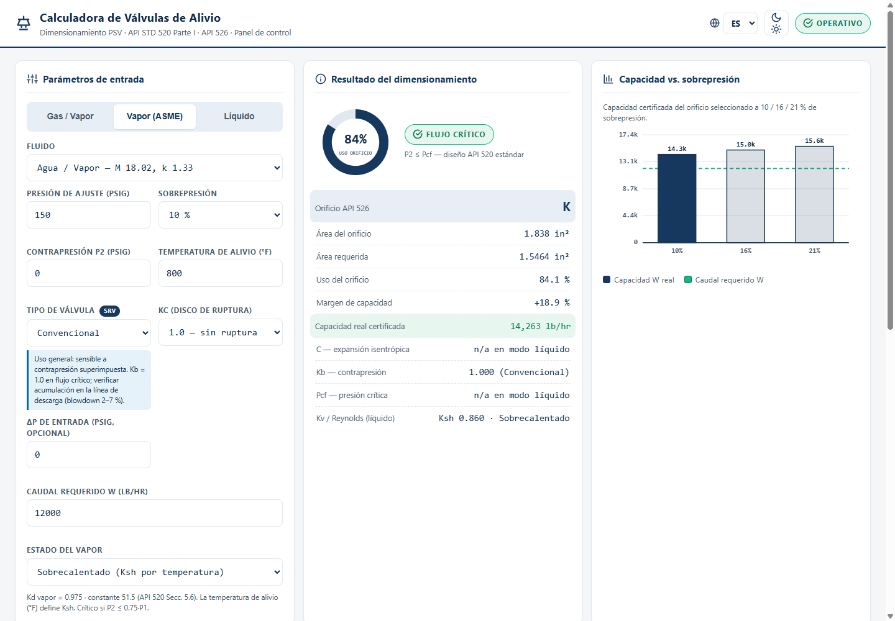 |  |
| **Líquido viscoso — corrección Kv iterativa** | **Válvula de fuelle — Kb por contrapresión** |
| 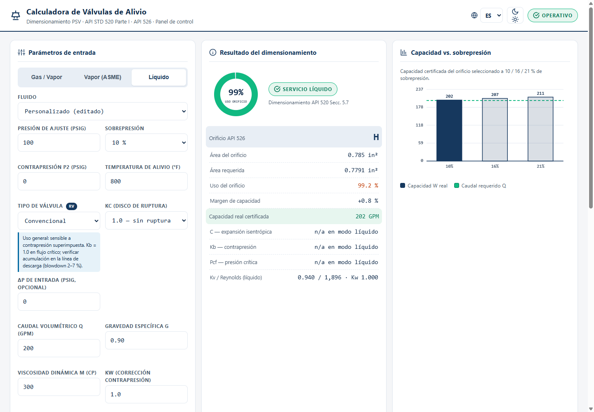 |  |
| **Válvula pilotada POSRV — Kb = 1.0** | **Tema oscuro Solarized** |
| 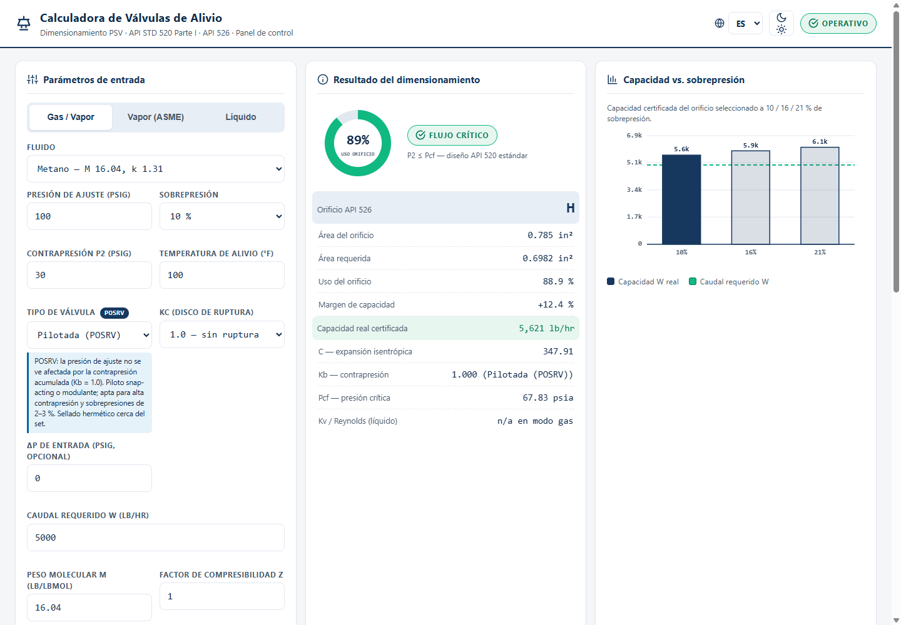 | 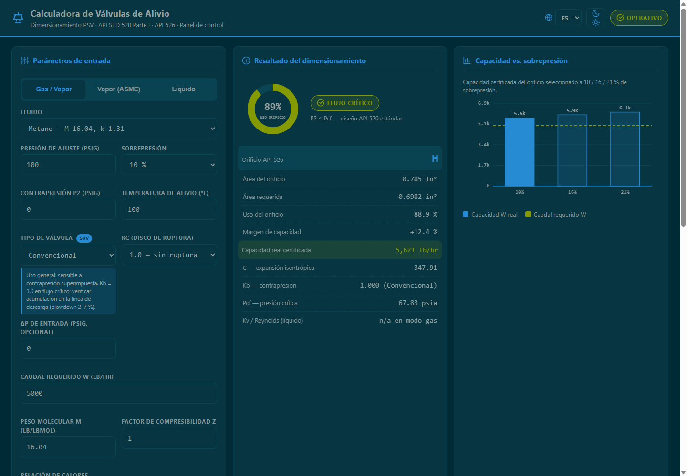 |
| **Interfaz en inglés** | **Hoja de especificación API 520 / ISA S20** |
| 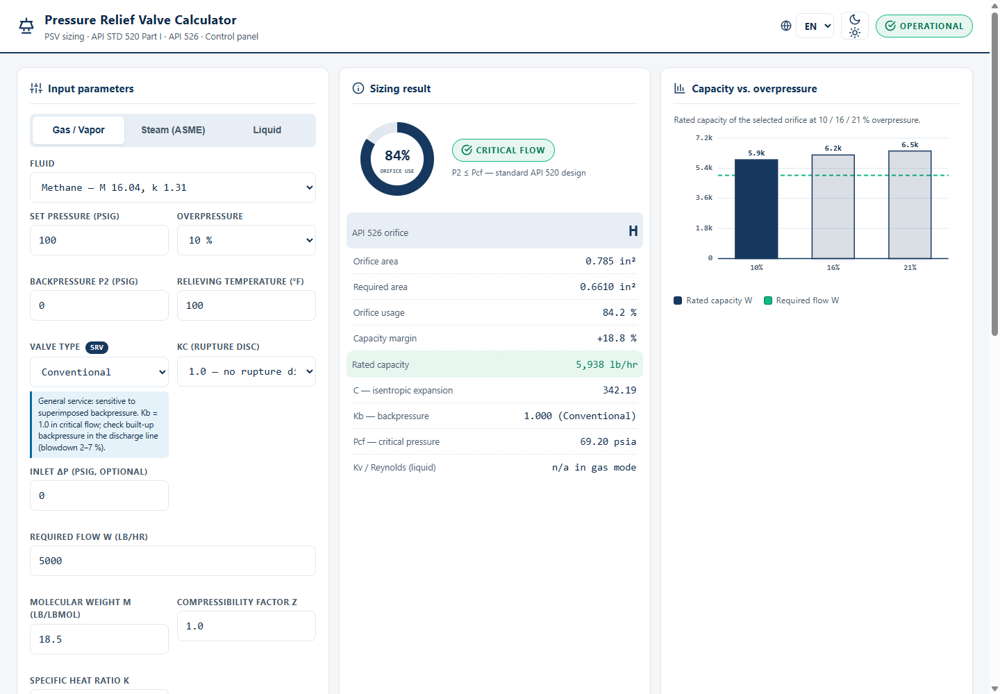 | 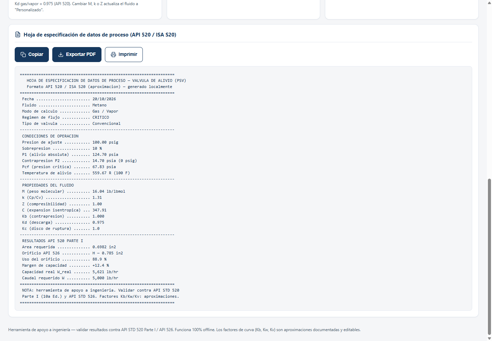 |
| **Validación reactiva inline** | **Tooltip del gráfico de capacidad** |
| 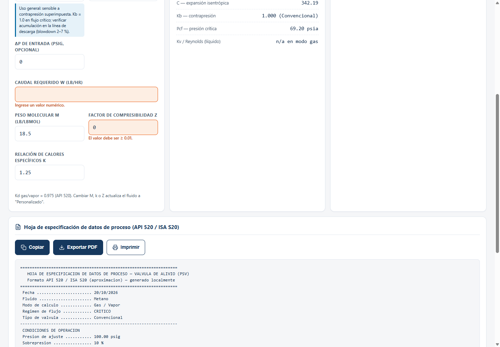 | 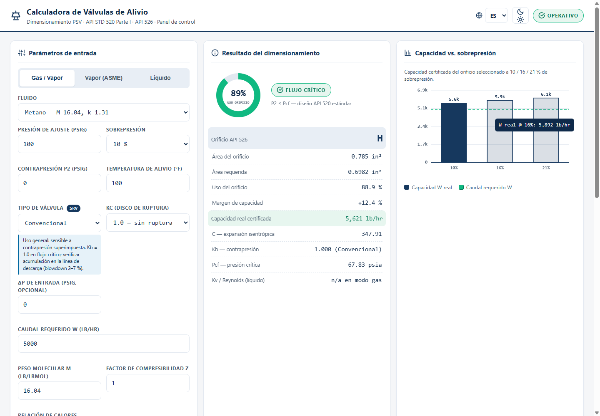 |

Guía visual del recorrido de uso:

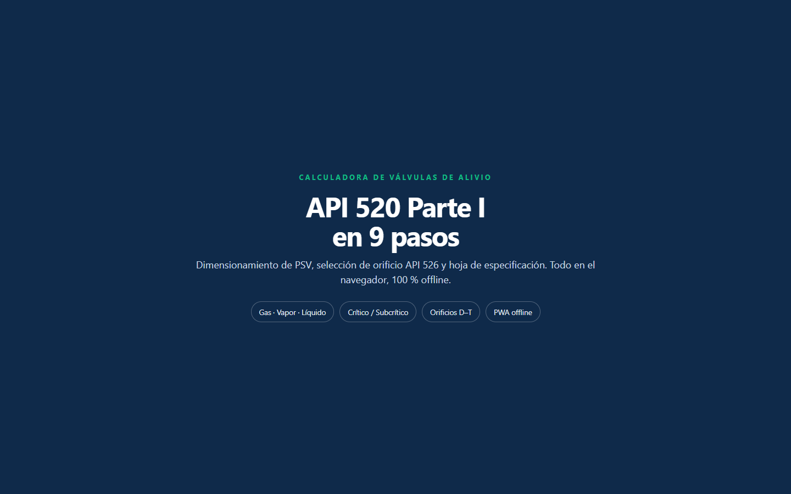

## Diagrama de flujo

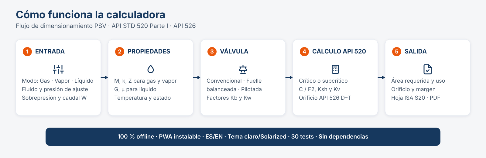

```mermaid
flowchart LR
    A[Entrada<br/>modo · fluido · P set · OP · P2 · T · caudal] --> B[Propiedades<br/>M · k · Z · G · μ · vapor]
    B --> C{Tipo de válvula}
    C -->|Convencional| D[Kb = 1.0 en crítico]
    C -->|Fuelle| E[Kb / Kw por % de contrapresión]
    C -->|POSRV| F[Kb = 1.0]
    D --> G{Régimen}
    E --> G
    F --> G
    G -->|Crítico| H[A = W / C·Kd·P1·Kb·Kc · √(TZ/M)]
    G -->|Subcrítico| I[A = W / 735·F2·Kd·Kc · √(ZT / M·P1·(P1−P2))]
    H --> J[Orificio API 526 D–T]
    I --> J
    J --> K[Uso · margen · capacidad real]
    K --> L[Hoja ISA S20 · copiar · PDF · imprimir]
```

## Funcionalidad

- **Tres modos de cálculo** con campos contextuales:
  - **Gas / vapor** — ecuación de flujo crítico y ecuación exacta de flujo subcrítico.
  - **Vapor (ASME)** — constante 51.5, factor de sobrecalentamiento `Ksh` y regla de criticidad `P2 ≤ 0.75·P1`.
  - **Líquido** — ecuación con constante 38, corrección por viscosidad `Kv` iterativa y Reynolds evaluado con el orificio seleccionado.
- **Tres tipos de válvula** con física diferenciada:
  - **Convencional** — `Kb = 1.0` en flujo crítico; aviso de sensibilidad a la contrapresión superimpuesta.
  - **Fuelle balanceada** — `Kb` y `Kw` según la contrapresión expresada como **% de la presión de ajuste**.
  - **Pilotada (POSRV)** — `Kb = 1.0`; la presión de ajuste no se ve afectada por la contrapresión acumulada.
- **Selección automática de orificio API 526** (D–T) con capacidad real, uso y margen.
- **Gráficos Canvas nativos**, sin librerías: donut de uso del orificio y barras de capacidad certificada a 10 / 16 / 21 % de sobrepresión, con tooltip.
- **Hoja de especificación** estilo API 520 / ISA S20: copiar al portapapeles, exportar PDF (jsPDF por CDN con *fallback* a impresión) e imprimir.
- **Validación reactiva inline** para valores vacíos, no numéricos y fuera de rango, más avisos de cumplimiento (regla del 3 % de ΔP de entrada y límite del 50 % de contrapresión en fuelle).
- **Bilingüe ES/EN** con preferencia persistente y **tema claro / Solarized oscuro** persistente en `localStorage`.
- **11 fluidos precargados editables**: metano, etano, propano, butano, gas natural típico, hidrógeno, nitrógeno, agua/vapor, gasolina, diésel y Jet A1.
- **PWA instalable** con service worker cache-first y funcionamiento offline tras la primera visita.

## Motor de cálculo

### Presión de alivio y régimen

La UI trabaja en **psig** y **°F**; el motor convierte a unidades absolutas API:

```text
P1 [psia] = P_set × (1 + sobrepresión/100) + 14.7
T  [°R]   = T_F + 459.67
P2 [psia] = P_contrapresión + 14.7
```

- **Gas:** crítico si `P2 ≤ Pcf`, con `Pcf = P1 · (2/(k+1))^(k/(k−1))`.
- **Vapor:** crítico si `P2 ≤ 0.75·P1` (aproximación ASME/API; por encima se marca **SUBCRÍTICO** y se recomienda consultar al fabricante).
- **Líquido:** siempre se calcula con `ΔP = P1 − P2`.

### Gas / vapor — flujo crítico

```text
A = W / (C · Kd · P1 · Kb · Kc) · √(T · Z / M)          [in²]

C = 520 · √( k · (2/(k+1))^((k+1)/(k−1)) )
```

| Símbolo | Significado | Valor / fuente |
|---|---|---|
| `W` | Caudal másico requerido | lb/hr |
| `C` | Coeficiente de expansión isentrópica | función de `k` |
| `Kd` | Coeficiente de descarga | 0.975 gas/vapor |
| `Kb` | Corrección por contrapresión | 1.0 convencional/POSRV; curva para fuelle |
| `Kc` | Corrección por disco de ruptura | 1.0 sin ruptura; 0.9 con ruptura |
| `T` | Temperatura absoluta de alivio | °R |
| `Z` | Factor de compresibilidad | adimensional |
| `M` | Peso molecular | lb/lbmol |

### Gas / vapor — flujo subcrítico (ecuación exacta)

```text
A = W / (735 · F2 · Kd · Kc) · √( Z·T / (M · P1 · (P1 − P2)) )     [in²]

F2 = √( (k/(k−1)) · r^(2/k) · (1 − r^((k−1)/k)) / (1 − r) ),  r = P2/P1
```

En régimen subcrítico la contrapresión ya está incorporada en `F2` y en `ΔP`, por lo que **`Kb = 1.0`**. La constante 735 es la forma USC; la equivalente SI es 17.9 (kg/h, kPa, mm²). La continuidad en `r = rc` está verificada contra la fórmula crítica (Δ < 0.1 %).

### Líquido

```text
A = Q / (38 · Kd · Kw · Kc · Kv) · √(G / ΔP)             [in²]

Kv = min(1, [0.9935 + 2.878/√Re + 342.75/Re^1.5]^−1)
Re = 2800 · Q · G / (μ · √A_orificio)
```

| Símbolo | Significado | Valor / fuente |
|---|---|---|
| `Q` | Caudal volumétrico | GPM |
| `G` | Gravedad específica | rel. agua a 4 °C |
| `ΔP` | `P1 − P2` | psi |
| `Kd` | Coeficiente de descarga | 0.65 líquido |
| `Kw` | Corrección por contrapresión | 1.0 convencional/POSRV; curva para fuelle |
| `Kv` | Corrección por viscosidad | iterativa, tope 1.0 |
| `μ` | Viscosidad dinámica | cP |

El procedimiento itera hasta 4 veces: calcula área → selecciona orificio API 526 → evalúa `Re` con el área de ese orificio → recalcula `Kv` → repite hasta converger (`|ΔKv| < 1e-4`).

### Vapor (ASME)

```text
A = W / (51.5 · Kd · P1 · Ksh · Kb · Kc)                 [in²]
```

`Ksh` se interpola linealmente entre 400 °F y 1000 °F sobre la curva publicada:

| T [°F] | 400 | 500 | 600 | 700 | 800 | 900 | 1000 |
|---|---|---|---|---|---|---|---|
| `Ksh` | 1.00 | 0.97 | 0.93 | 0.90 | 0.86 | 0.83 | 0.80 |

Vapor saturado: `Ksh = 1.0`.

### Factores de contrapresión para fuelle

`Kb` en gas/vapor (curva base a 10 % de sobrepresión; a 21 % `Kb = 1.0` hasta 50 % de contrapresión; a 16 % interpolación documentada):

| Contrapresión [% del set] | 0 | 10 | 20 | 30 | 40 | 50 |
|---|---|---|---|---|---|---|
| `Kb` (10 % OP) | 1.00 | 0.99 | 0.97 | 0.95 | 0.91 | 0.86 |

`Kw` en líquido:

| Contrapresión [% del set] | 0 | 10 | 20 | 30 | 40 | 50 |
|---|---|---|---|---|---|---|
| `Kw` | 1.00 | 0.95 | 0.91 | 0.88 | 0.86 | 0.86 |

> La contrapresión se normaliza como `P_back / P_set × 100`, que es el eje de la curva API 520 Fig. 30. La corrección se aplicó en la v1.3.0; antes la UI no enviaba ese porcentaje al motor y una válvula de fuelle con 30 psig y set 100 psig mostraba `Kb = 1.000` en lugar de `0.950`.

## Unidades y conversiones

| Magnitud | Entrada UI | Motor | Salida |
|---|---|---|---|
| Presión de ajuste | psig | psia (`+14.7`) | psig / psia |
| Contrapresión | psig | psia (`+14.7`) | psig / psia |
| Temperatura gas | °F | °R (`+459.67`) | °R / °F |
| Temperatura vapor | °F | °F (para `Ksh`) | °F / °R en hoja |
| Caudal gas/vapor | lb/hr | lb/hr | lb/hr |
| Caudal líquido | GPM | GPM | GPM |
| Área | — | in² | in² |
| Viscosidad | cP | cP | cP |
| Gravedad específica | — | adimensional | adimensional |

## Selección de orificio API 526

| Letra | Área [in²] | Letra | Área [in²] |
|---|---:|---|---:|
| D | 0.110 | N | 4.340 |
| E | 0.196 | P | 6.380 |
| F | 0.307 | Q | 11.05 |
| G | 0.503 | R | 16.00 |
| H | 0.785 | T | 26.00 |
| J | 1.287 | | |
| K | 1.838 | | |
| L | 2.853 | | |
| M | 3.600 | | |

La selección toma el **primer orificio con área ≥ área requerida** y calcula:

```text
uso [%]    = A_requerida / A_orificio × 100
margen [%] = (A_orificio / A_requerida − 1) × 100
W_real     = capacidad certificada con el área del orificio seleccionado
```

Si el área requerida supera el orificio T (26.00 in²), la app muestra un error explícito.

## Supuestos, aproximaciones y límites

- Las curvas `Kb`, `Kw` y `Ksh` son **aproximaciones documentadas** de figuras de API 520 (material de pago), implementadas como tablas editables en el código. No sustituyen la lectura de la edición vigente.
- El régimen subcrítico de vapor se marca como aviso; API recomienda verificar la selección con el fabricante en ese régimen.
- La regla del 3 % de ΔP de entrada y el límite del 50 % de contrapresión en fuelle se muestran como **avisos de cumplimiento**, no bloquean el cálculo.
- La hoja de especificación es una **aproximación de formato** API 520 / ISA S20, no un documento certificado.
- La exportación a PDF usa jsPDF por CDN; si no hay red, cae a la impresión del navegador.
- Los valores de fluidos son puntos de partida típicos y **editables**; para servicios reales deben usarse propiedades del proceso.
- La app no modela dos fases, sólidos, condensación, reacciones, ni transitorios de alivio.
- Rango de la UI pensado para escritorio/tablet (resolución mínima recomendada 1366×768); no es una app móvil de bolsillo.

## Arquitectura

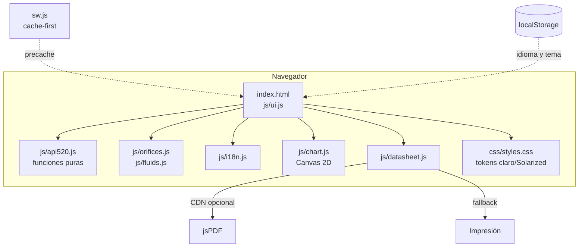

Principios:

- **Núcleo puro y testeable**: `js/api520.js` no toca el DOM y se expone como `window.API520`; los tests de Node lo cargan directamente.
- **Sin dependencias de runtime**: HTML, CSS y JavaScript nativos. Solo jsPDF se carga bajo demanda para exportar PDF.
- **Estado mínimo**: el estado de cálculo vive en `ui.js`; las preferencias (idioma/tema) en `localStorage`.
- **Gráficos con tokens**: `chart.js` lee las variables CSS en cada dibujo, por lo que el tema oscuro funciona sin duplicar paletas.
- **Offline-first**: `sw.js` precachea el núcleo y sirve cache-first con revalidación en segundo plano.

## Estructura del proyecto

```text
api520-calculator/
├── index.html                 # Panel HMI (3 columnas + datasheet)
├── css/
│   └── styles.css             # Tokens, Bento Grid, temas, print, responsive
├── js/
│   ├── api520.js              # Motor puro API 520 / selección API 526
│   ├── orifices.js            # Tabla API 526 D–T (fuente única)
│   ├── fluids.js              # Catálogo de 11 fluidos
│   ├── i18n.js                # Diccionarios ES/EN
│   ├── chart.js               # Donut y barras Canvas + tooltip
│   ├── datasheet.js           # Hoja ISA S20, portapapeles, PDF, print
│   └── ui.js                  # Estado, validación, render, tema, idioma
├── tests/
│   └── run.js                 # Suite TDD con node:assert/strict
├── docs/
│   ├── banner.svg
│   ├── diagrama-flujo.svg
│   ├── guia-visual.png
│   └── screenshots/           # 13 capturas reales de la app
├── icons/icon.svg
├── manifest.json              # PWA
├── sw.js                      # Service worker (cache v11)
├── CHANGELOG.md
├── LICENSE
└── README.md
```

## Ejecución

### Web (archivo o servidor estático)

```bash
# Opción A: abrir directamente (funciona desde file://)
start index.html

# Opción B: servidor estático
npx serve .
# o: python -m http.server 8080
```

### Windows (PWA instalable)

1. Sirve la app por HTTP (`npx serve .`) o publícala en cualquier hosting estático.
2. Abre **Edge o Chrome** → icono de instalación en la barra de direcciones → **Instalar**.
3. Tras la primera carga, el service worker cachea el núcleo y la app funciona offline.
4. Navegación completa por teclado (Tab, foco visible); resolución mínima recomendada 1366×768.

### Windows (.exe nativo con Electron, opcional)

```bash
npm init -y
npm install --save-dev electron electron-packager
# main: "index.html" en package.json
npx electron .                         # prueba local
npx electron-packager . CalculadoraAPI520 --platform=win32 --arch=x64 --out=dist
# → dist/CalculadoraAPI520-win32-x64/CalculadoraAPI520.exe
```

## Pruebas

```bash
node tests/run.js
```

Suite TDD sin framework (`node:assert/strict`) con **30 casos**:

| Grupo | Casos | Qué cubre |
|---|---:|---|
| Núcleo gas | 6 | Coeficiente `C`, área crítica, selección de orificio, `Pcf`, regresión de `Kd`, continuidad crítica/subcrítica |
| Líquido | 4 | Área, `Kv` API, Reynolds con orificio seleccionado, `Kw` de fuelle |
| Vapor | 5 | Constante 51.5, `Ksh` saturado/sobrecalentado, subcrítico, validación `P2 < P1` |
| Subcrítico exacto | 2 | Caso manual `F2 = 0.9289 → A = 0.7746 in²` y continuidad |
| Válvulas y contrapresión | 5 | `Kb` interpolado, POSRV, fuelle por sobrepresión, `Kb` por % del set (gas y vapor) |
| Fluidos | 2 | Catálogo completo y correcciones (etano, Jet A1, diésel) |
| i18n | 1 | Paridad de claves ES/EN no vacías |
| Validaciones | 5 | `Z`, `k`, `P1`, subcrítico exige más área, errores numéricos |

Salida esperada:

```text
30/30 tests OK — todo verde
```

## Rendimiento, offline y privacidad

- **Sin backend ni telemetría**: no hay peticiones de datos; la única petición externa opcional es jsPDF al exportar PDF.
- **Sin dependencias de runtime**: el núcleo pesa ~50 KB de JS sin minificar; los gráficos son Canvas 2D nativo.
- **Service worker cache-first** con precache del núcleo (HTML, CSS, JS, manifest e icono) y limpieza de cachés antiguas al activar (`bpi-api520-v11`).
- **Persistencia local** únicamente de idioma y tema (`localStorage`); no se guardan datos de proceso.
- **Apto para equipos aislados** (Toughbook, tablet de campo, red segmentada) una vez cargada la app.

## Accesibilidad y diseño

- Tokens únicos en `:root` (`css/styles.css`): fondo `#f5f6f8`, tarjetas `#ffffff`, navy `#16385e`, texto `#0f2a4a`, esmeralda operativo `#10b981`, naranja de seguridad `#ea580c`.
- Tema oscuro **Solarized Dark** por override de tokens (`data-theme="dark"`), sin duplicar componentes.
- Bento Grid plano, sin gradientes, una sombra sutil, tipografía `system-ui` y mono para valores.
- Contraste ≥ 4.5:1, foco visible, objetivos ≥ 44×44 px, `aria-label` en gráficos, `role="alert"` en errores y `aria-live` en avisos.
- Textos y etiquetas traducidos con `data-i18n` / `data-i18n-aria`; gráficos traducen sus leyendas mediante `I18N`.
- Impresión con área dedicada (`#print-area`) y estilos `@media print`.

## Referencias

Fórmulas, constantes, tabla API 526, factores de corrección y propiedades de fluidos verificados contra:

- Technical Toolboxes Knowledge Center — *API 520 – Relief Valves Requiring Capacity Certification* (fórmula de líquido con constante 38, regla `Kw` por tipo de válvula, correlación `Kv = (0.9935 + 2.878/√Re + 342.75/Re^1.5)^−1`, `Re = 2800·Q·G/(μ·√A)`): <https://help.technicaltoolboxes.com/knowledge-base/api-520-relief-valves-requiring-capacity-certification/>
- Neutrium — *Relief Valve Orifice Area to API RP 526* (tabla D–T exacta): <https://neutrium.net/articles/equipment/relief-valve-orifice-area-to-api-rp-526/>
- ProcessTools — *Relief Valve Sizing Theory* (fórmulas gas/líquido/vapor, `Kd` 0.975/0.65, sobrepresión 10/16/21 %): <https://processtools.app/relief-valve/theory>
- FlowMachinery — *PRV Orifice Sizing per API 526 Guide* (`P1 = set×1.10 + atm`, regla de 3 % de pérdida de entrada): <https://flowmachinery.com/valves/pressure-relief-valve-orifice>
- Wikipedia — *Choked flow* (relación crítica, `γ` de gases vía Perry's Table 2-166), *Relief valve* (terminología PRV/PSV/RV/SRV/POSRV), *Pilot-operated relief valve* (snap vs modulating), *Gasoline*, *Diesel fuel*, *Jet fuel*, *Ethane*: <https://en.wikipedia.org/wiki/Choked_flow> · <https://en.wikipedia.org/wiki/Relief_valve> · <https://en.wikipedia.org/wiki/Pilot-operated_relief_valve>
- Engineering ToolBox — *Molecular weights of gases/vapors* y *Specific heat ratios*: <https://www.engineeringtoolbox.com/molecular-weight-gas-vapor-d_1156.html>
- Cheresources (foro de expertos) — límite de fuelle ≤ 50 % BP y `Kb = 1.0` a 21 % de sobrepresión (Fig. 30 API 520 7.ª ed.): <https://www.cheresources.com/invision/topic/15761-back-pressure-correction-factor-for-balanced-bellows-psv/>

### Correcciones aplicadas tras la verificación

1. Correlación `Kv`: sustituida por la publicada en API 520 (antes una fit con exponentes incorrectos).
2. Reynolds: ahora evalúa el área del orificio estándar seleccionado (procedimiento API).
3. `Kb` de fuelle: curva dependiente de la sobrepresión (10 % → curva Fig. 30; 21 % → 1.0 hasta 50 %; 16 % → interpolación documentada).
4. Fluidos: etano `G` 0.36 → 0.544 (544 kg/m³ a −88.5 °C); Jet A1 `M` 150 → 170 y `μ` 1.7 → 1.4 cP; diésel `G` 0.85 → 0.84 (EN 590).
5. **v1.3.0** — `Kb` de fuelle recibe la contrapresión como % del set desde la UI (`Kb = 0.950` con 30 psig / set 100 psig); antes se enviaba 0 % y el resultado era 1.000.

## Aviso de ingeniería

Herramienta de apoyo. Los factores de curva (`Kb` de fuelle, `Kw` de fuelle, `Ksh`, `Kv` de viscosidad) son **aproximaciones documentadas** de las curvas API 520 Parte I y son editables. Validar siempre contra las ediciones vigentes de **API STD 520 / 526** y los datos del fabricante de la válvula antes de especificar, comprar o instalar un dispositivo de alivio.

## Licencia

MIT — ver [LICENSE](LICENSE). Cambios de ingeniería trazables en [CHANGELOG.md](CHANGELOG.md).
